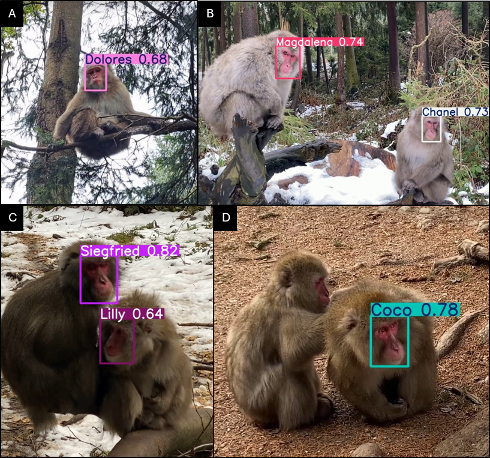

# Smart Monkey Lab

  
  &nbsp;&nbsp;&nbsp;&nbsp;
  

  
  &nbsp;&nbsp;&nbsp;&nbsp;
  

Smart Monkey Lab is a study of individual face recognition in Japanese macaques (*Macaca fuscata*) living semi-free in a forest enclosure at Affenberg Landskron, Austria. The aim is a way to recognise the animals from ordinary video, without tags or collars, so that long-term behaviour work can rest on who is who.

Filming ran across four seasons, from summer 2023 to winter 2025. Each clip was of one animal, already alone, and the file name carried that animal’s identity. A face finder then kept the frames with a single face and attached the name from the file. That is how a very large labelled set was built with little hand drawing.

## People

The work is shared by the Department for Spatial Informatics for Environmental Applications (SIENA) at the Carinthia University of Applied Sciences, and the Affenberg Research Station in the Department of Behavioral and Cognitive Biology at the University of Vienna.

Sadoun Mohammad Mustafa built the recognition system. Roy Hammer and Lena S. Pflüger led the fieldwork and the animal records at Affenberg. Gernot Paulus and Karl-Heinrich Anders supervised the project at SIENA.

The Affenberg team made the study possible, in particular the managers Svenja and Peter Gaubatz, and Lena von Verschuer, who gave access to the macaque group and supported the filming.

## Funding

The study was funded by the Austrian Research Promotion Agency (FFG) under the Bridge programme, project FO999898920, short title Smart Monkey Lab.

## Data

| | |
| --- | --- |
| Collection periods | summer 2023, winter 2024, summer 2024, winter 2025 |
| Videos | 726 |
| Annotated frames | 723,835 |
| Training frames | 509,186 (70.35%) |
| Validation frames | 214,649 (29.65%) |

## Performance

Winter 2025 validation:

| Precision | Recall | mAP50 | mAP50-95 |
| --- | --- | --- | --- |
| 91.90% | 89.30% | 93.30% | 69.10% |

Validation mAP50 by period: 72.65%, 80.50%, 87.70%, 93.30%.

Test mAP50 on the 39,017 single-animal frames: 84.83%. Test precision: 85.5%.

  

